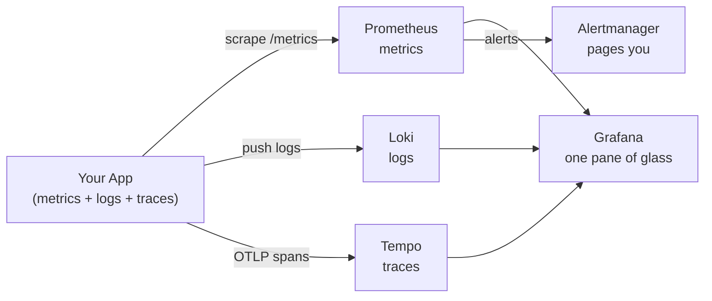
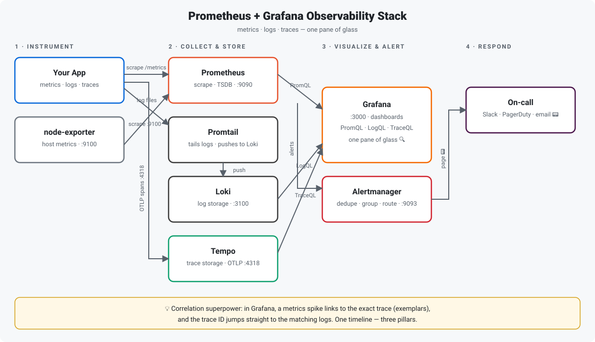

# Prometheus + Grafana Observability Stack


> Your app is down at 3 AM. Do you have dashboards — or do you have `ssh` and hope?

## TL;DR

Observability isn't "installing Grafana". It's wiring the **three pillars** — metrics, logs, traces — into one correlated view so a spike on a dashboard takes you straight to the guilty log line and the exact trace. This repo is a production-shaped reference stack you can boot with one command: **Prometheus** scrapes metrics, **Loki** collects logs, **Tempo** stores traces, **Grafana** glues them together, and **Alertmanager** wakes you up before users do.



## The Three Pillars, Compared

| | Metrics | Logs | Traces |
|---|---|---|---|
| **What** | Numbers over time (counters, gauges, histograms) | Timestamped text events | A request's journey across services |
| **Storage** | Prometheus (TSDB) | Loki (label-indexed) | Tempo (object storage) |
| **Question it answers** | *"Is error rate spiking?"* | *"What exactly failed?"* | *"Where did the 2s latency come from?"* |
| **Cost profile** | Cheap, fixed cardinality | Expensive if you're sloppy with labels | Sampled (keep 1–10%) |
| **Cardinality trap** | `user_id` as a label → 💥 | High-cardinality labels → 💥 | Unsampled everything → 💥 |

**The correlation superpower:** one Grafana dashboard where clicking a metrics spike jumps to the logs for that time range *and* the trace exemplars behind it. That's the difference between observability and three disconnected tools.

## Architecture



How the pieces fit:

1. **Instrumentation** — your app exposes `/metrics` (Prometheus format), ships structured logs, and emits OTLP traces. Exporters (e.g. `node-exporter`) cover the host.
2. **Collection** — Prometheus *pulls* metrics on a scrape interval; Promtail *pushes* logs to Loki; the app *pushes* spans to Tempo over OTLP.
3. **Visualization** — Grafana is the single frontend with all three as data sources. One dashboard, three pillars, linked by time range and trace IDs.
4. **Alerting** — Prometheus evaluates rules, fires to Alertmanager, which dedupes, groups, silences, and routes (Slack, PagerDuty, email).

## Quickstart

```bash
docker compose up -d

# Grafana    → http://localhost:3000  (admin / admin)
# Prometheus → http://localhost:9090
# Alertmanager → http://localhost:9093
```

The stack runs on official images with their built-in defaults. Extend it by mounting your own `prometheus.yml` (scrape jobs) and `alerts.yml` (rules) — see the comments in `docker-compose.yml`.

## Sample Alert Rule

```yaml
# alerts.yml — page BEFORE users notice
groups:
  - name: service-health
    rules:
      - alert: HighErrorRate
        expr: |
          sum(rate(http_requests_total{status=~"5.."}[5m]))
          / sum(rate(http_requests_total[5m])) > 0.05
        for: 5m
        labels:
          severity: critical
        annotations:
          summary: "Error rate above 5% for 5 minutes"

      - alert: TargetDown
        expr: up == 0
        for: 2m
        labels:
          severity: warning
        annotations:
          summary: "Prometheus target {{ $labels.job }} is down"
```

Rules of thumb: alert on **symptoms** (error rate, latency, saturation — the USE/RED methods), not causes. Every alert needs a runbook link; an alert nobody knows how to fix is just noise.

## Metrics: RED and USE

- **RED** (for request-driven services): **R**ate, **E**rrors, **D**uration. If you track nothing else, track these three per service.
- **USE** (for resources): **U**tilization, **S**aturation, **E**rrors. For every CPU, disk, queue, and connection pool.

## Gotchas That Bite Everyone

- **Cardinality explosion** — a label with unbounded values (`user_id`, `request_path` with IDs) will OOM Prometheus. Aggregate or drop at scrape time with `relabel_configs`.
- **Alert fatigue** — 50 noisy alerts = 0 alerts anyone reads. Start with 3–5 symptom-based alerts, tune thresholds from real data.
- **Logs without structure** — plain-text logs are grep-able, JSON logs are queryable. Loki loves labels like `app`, `env`, `level` — keep them low-cardinality.
- **Traces without sampling** — storing 100% of traces at scale will bankrupt you. Sample aggressively (head-based 1–5%), keep 100% of errors.

## What's in This Repo

| File | What it is |
|---|---|
| `README.md` | This guide |
| `architecture.svg` | Stack architecture diagram |
| `docker-compose.yml` | Runnable stack: Prometheus, Grafana, Loki, Promtail, Tempo, Alertmanager |
| `quiz.md` | 5 questions to test yourself |

## Quiz Teaser 🧠

> Your Prometheus uses 40 GB of RAM and keeps OOMKilling. `topk(10, count by (__name__)({__name__=~".+"}))` shows one metric with 2 million series. What's the most likely cause — and the one-line fix?
>
> Answer in [`quiz.md`](quiz.md) (Q3). No peeking. 😏
